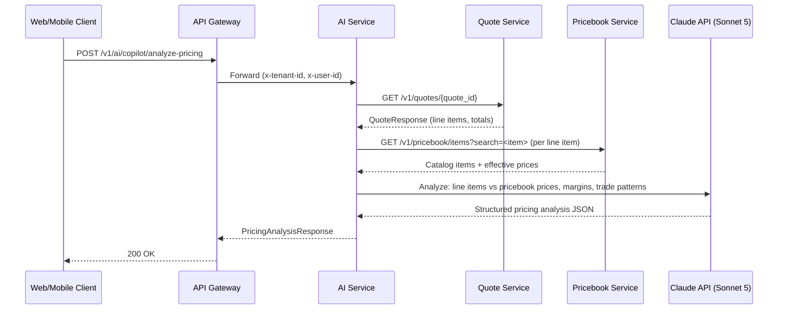
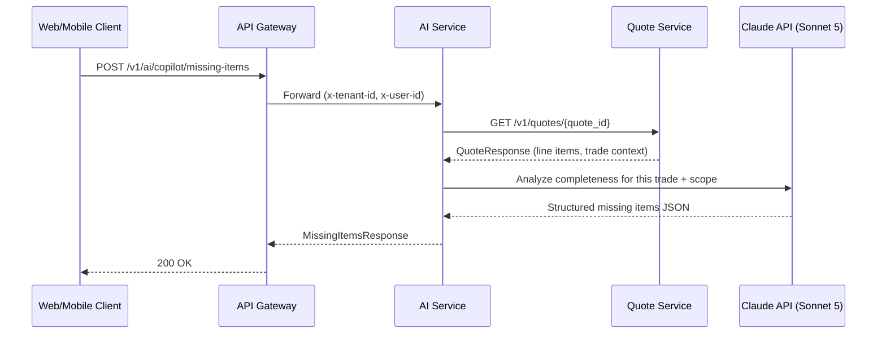
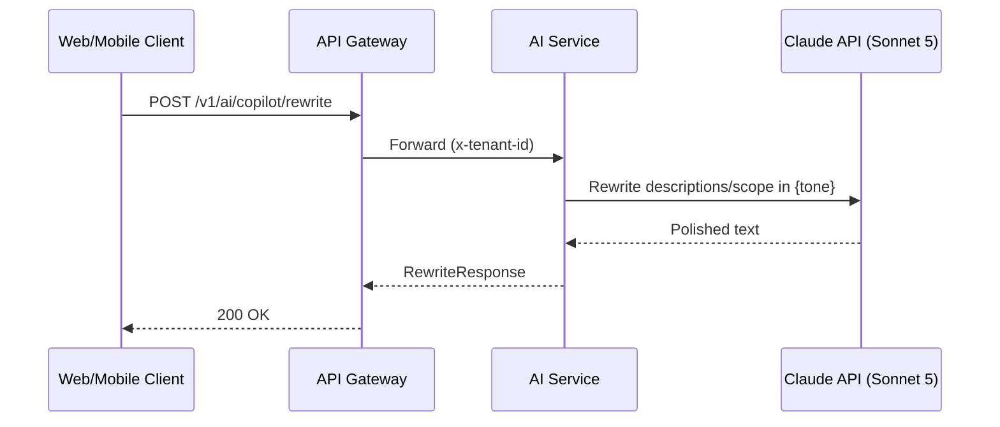

# T202 — AI Copilot: Complete Development Plan

**Module:** M16 · **Owner:** Agent 1 (CTO / Opus 4.8) · **Support:** Agent 3 (Gemini)
**Deps:** T106 ✅ (Quote Engine) · T201 ✅ (AI Quote Assistant — ai-service built)
**Unblocks:** T304 (AI Vision), T305 (AI OCR), T306 (AI Sales Coach)
**Bounded Context:** `services/ai-service` (extends, not replaces) · **Phase:** 2

---

## Executive Summary

T202 adds the **AI Copilot** — the intelligence layer that sits alongside an existing quote and
answers the four questions every contractor asks:

1. 💰 **"How much should I charge?"** — pricing benchmarking against pricebook data
2. 🔍 **"What's missing?"** — trade-aware completeness analysis that catches forgotten materials/labor
3. 📈 **"Can I increase my profit?"** — margin analysis with actionable optimization suggestions
4. ✏️ **"Rewrite this professionally."** — converts trade shorthand into polished customer-facing text

Unlike T201 (which _creates_ a new quote from scratch), T202 _reads_ an existing quote and returns
**advisory insights** — it never mutates the quote. The contractor reviews suggestions and applies
them manually, maintaining full control. This makes every copilot endpoint a pure read + LLM call
with no service-to-service write path, simpler than T201.

---

## User Review Required

> [!IMPORTANT]
> **Model tier:** T201 uses `claude-opus-5` because structured-output schema compliance was
> non-negotiable for scope extraction. Copilot endpoints are advisory text — **Sonnet 5** is 40%
> cheaper, significantly faster, and produces high-quality prose/analysis. Recommend **claude-sonnet-5**
> for copilot, falling back to Opus only if output quality is insufficient. Confirm or override.

> [!IMPORTANT]
> **Pricing analysis data source:** The "how much should I charge?" endpoint needs a reference point.
> For MVP, it compares against the tenant's _own pricebook_ (`GET /v1/pricebook/items`). Regional
> benchmarking against aggregate data requires a shared pricing database (no such table exists yet).
> Recommend **pricebook-only for T202**, with regional benchmarking deferred to M21 (Analytics).

> [!WARNING]
> **Quote read path:** The copilot reads the full quote (with line items) from quote-service via
> `GET /v1/quotes/{quote_id}`. This is an idempotent read per ADR-0003, fully safe to retry/cache.
> No new service-to-service write calls are introduced.

---

## Open Questions

> [!IMPORTANT]
> **Q1: Quote reader — new protocol or reuse HttpQuoteCreator?** The copilot needs to _read_
> quotes (`GET /v1/quotes/{id}`), but the existing `HttpQuoteCreator` only _writes_ (`POST`). Add a
> new `QuoteReader` protocol + `HttpQuoteReader` adapter, or extend the existing class?
> **Recommendation:** New `QuoteReader` protocol — keeps read and write concerns separated (ISP),
> and the class naming would be misleading if a "creator" also reads.

> [!IMPORTANT]
> **Q2: Combined endpoint or separate?** Should there be one `POST /v1/ai/copilot/analyze` that
> returns pricing + missing items + margin in a single response, or three separate endpoints?
> **Recommendation:** Three separate endpoints (analyze-pricing, missing-items, rewrite). Each has
> distinct prompt engineering and different latency profiles. A combined endpoint would delay the
> response until the slowest sub-task finishes and mix concerns. The frontend can fire them in
> parallel. Margin analysis is embedded in analyze-pricing since the data overlaps entirely.

> [!IMPORTANT]
> **Q3: Rewrite scope vs. line items.** Should the `/rewrite` endpoint rewrite individual line-item
> descriptions, the full scope-of-work text, or both? **Recommendation:** Accept _either_ a list of
> line-item descriptions or a single scope text block. The prompt handles both; the response mirrors
> the input shape. This covers the T201b scope-writer action _and_ per-line polish.

---

## Architecture Design

### System Flow: Analyze Pricing



### System Flow: Missing Items



### System Flow: Rewrite



> [!NOTE]
> The rewrite endpoint does **not** call quote-service or pricebook-service. It receives the text
> inline and returns polished text — no service-to-service dependency, no ADR-0003 concern.

---

## Proposed Changes

### Component 1: Domain Layer Extensions (`services/ai-service/app/domain/`)

#### [MODIFY] [models.py](file:///d:/TradeQuote%20AI/services/ai-service/app/domain/models.py)

Add `AiFeature.COPILOT` to the enum (matching the canonical `"copilot"` in `packages/types`) and
new domain value objects for copilot results:

```python
class AiFeature(str, enum.Enum):
    VOICE = "voice"
    SCOPE_WRITER = "scope_writer"
    COPILOT = "copilot"          # ← NEW


# ── NEW copilot domain models ──

@dataclass(slots=True, frozen=True)
class QuoteLineItem:
    """A line item as read back from quote-service — the copilot's input."""
    id: UUID
    kind: str
    description: str
    quantity: float
    unit: str
    unit_cost_minor: int
    markup_bps: int
    unit_price_minor: int
    line_total_minor: int
    pricebook_item_id: UUID | None = None
    is_optional: bool = False


@dataclass(slots=True, frozen=True)
class QuoteSnapshot:
    """Read-only view of a quote for copilot analysis."""
    quote_id: UUID
    trade_hint: str | None          # from title or created_via context
    currency: str
    tax_rate_bps: int
    subtotal_minor: int
    tax_minor: int
    total_minor: int
    line_items: tuple[QuoteLineItem, ...]


@dataclass(slots=True, frozen=True)
class PricingSuggestion:
    """One pricing suggestion for a single line item."""
    line_item_id: UUID
    current_unit_cost_minor: int
    current_markup_bps: int
    current_unit_price_minor: int
    suggested_unit_cost_minor: int | None   # null if current is fine
    suggested_markup_bps: int | None        # null if current is fine
    pricebook_unit_cost_minor: int | None   # what the pricebook says
    reasoning: str


@dataclass(slots=True, frozen=True)
class MarginAnalysis:
    """Quote-level margin summary."""
    total_cost_minor: int
    total_revenue_minor: int            # subtotal (excludes tax)
    gross_margin_bps: int               # (revenue - cost) / revenue * 10000
    average_markup_bps: int
    low_margin_item_ids: tuple[UUID, ...]  # items below 20% margin
    recommendation: str                 # LLM-generated margin advice


@dataclass(slots=True, frozen=True)
class PricingAnalysisResult:
    """Complete analyze-pricing output."""
    suggestions: tuple[PricingSuggestion, ...]
    margin: MarginAnalysis
    model_id: str
    tokens_used: int


@dataclass(slots=True, frozen=True)
class MissingItem:
    """One item the copilot thinks is missing from the quote."""
    description: str
    category: str                      # "material" | "labor" | "equipment"
    item_name: str                     # pricebook-searchable name
    estimated_quantity: Decimal
    unit: str
    reasoning: str                     # why this is needed
    priority: str                      # "critical" | "recommended" | "optional"


@dataclass(slots=True, frozen=True)
class MissingItemsResult:
    """Complete missing-items output."""
    missing: tuple[MissingItem, ...]
    trade: Trade
    completeness_score: int            # 0-100 estimate of how complete the quote is
    summary: str                       # LLM-generated summary
    model_id: str
    tokens_used: int


@dataclass(slots=True, frozen=True)
class RewriteResult:
    """Complete rewrite output."""
    rewritten: tuple[str, ...]         # 1:1 with input texts
    model_id: str
    tokens_used: int
```

#### [MODIFY] [protocols.py](file:///d:/TradeQuote%20AI/services/ai-service/app/domain/protocols.py)

Add protocols for the new copilot dependencies:

```python
class QuoteReader(Protocol):
    def get_quote(self, tenant_id: UUID, user_id: UUID | None, quote_id: UUID) -> QuoteSnapshot:
        """Read the full quote with line items from quote-service."""
        ...


class CopilotAnalyzer(Protocol):
    def analyze_pricing(
        self, quote: QuoteSnapshot, pricebook_context: list[PricebookMatch]
    ) -> tuple[PricingAnalysisResult, AiUsage]:
        """Analyze pricing and margins, return suggestions."""
        ...

    def find_missing_items(
        self, quote: QuoteSnapshot, job_description: str | None = None
    ) -> tuple[MissingItemsResult, AiUsage]:
        """Detect missing materials/labor/equipment for this trade."""
        ...


class TextRewriter(Protocol):
    def rewrite(
        self, texts: list[str], tone: str, context_hint: str | None = None
    ) -> tuple[list[str], AiUsage]:
        """Rewrite descriptions/scope text in the given tone."""
        ...
```

#### [MODIFY] [errors.py](file:///d:/TradeQuote%20AI/services/ai-service/app/domain/errors.py)

Add copilot-specific errors:

```python
class QuoteNotFoundError(Exception):
    """The requested quote doesn't exist or is in another tenant (→ 404)."""

class CopilotAnalysisError(Exception):
    """The LLM returned something that isn't a usable copilot analysis (→ 422)."""
```

---

### Component 2: Application Layer — Use Cases (`services/ai-service/app/application/`)

#### [NEW] `app/application/copilot_pricing.py`

```python
class AnalyzePricingUseCase:
    """Reads a quote, gathers pricebook context, and asks the LLM to analyze pricing/margins."""

    def __init__(
        self,
        quote_reader: QuoteReader,
        matcher: PricebookMatcher,
        analyzer: CopilotAnalyzer,
        usage_repo: AiUsageRepository,
        *,
        daily_cap_minor: int = 0,
    ) -> None: ...

    def execute(
        self,
        *,
        tenant_id: UUID,
        user_id: UUID | None,
        quote_id: UUID,
    ) -> tuple[PricingAnalysisResult, list[DomainEvent]]:
        # 1. Check spend cap
        # 2. Read quote from quote-service (GET, safe to retry per ADR-0003)
        # 3. For each line item with a pricebook_item_id, look up current pricebook cost
        # 4. Send to LLM: line items + pricebook context → pricing suggestions + margin analysis
        # 5. Record usage
        # 6. Emit ai.usage.recorded event
```

#### [NEW] `app/application/copilot_missing.py`

```python
class FindMissingItemsUseCase:
    """Reads a quote and asks the LLM what's missing based on trade-specific knowledge."""

    def __init__(
        self,
        quote_reader: QuoteReader,
        analyzer: CopilotAnalyzer,
        usage_repo: AiUsageRepository,
        *,
        daily_cap_minor: int = 0,
    ) -> None: ...

    def execute(
        self,
        *,
        tenant_id: UUID,
        user_id: UUID | None,
        quote_id: UUID,
        job_description: str | None = None,
    ) -> tuple[MissingItemsResult, list[DomainEvent]]:
        # 1. Check spend cap
        # 2. Read quote from quote-service
        # 3. Send to LLM: line items + trade context → missing items analysis
        # 4. Record usage
        # 5. Emit ai.usage.recorded event
```

#### [NEW] `app/application/copilot_rewrite.py`

```python
class RewriteUseCase:
    """Rewrites line-item descriptions or scope text in the requested tone."""

    def __init__(
        self,
        rewriter: TextRewriter,
        usage_repo: AiUsageRepository,
        *,
        daily_cap_minor: int = 0,
    ) -> None: ...

    def execute(
        self,
        *,
        tenant_id: UUID,
        user_id: UUID | None,
        texts: list[str],
        tone: str = "professional",
        context_hint: str | None = None,
    ) -> tuple[RewriteResult, list[DomainEvent]]:
        # 1. Check spend cap
        # 2. Validate/normalize tone (reuse scope_writer.normalize_tone)
        # 3. Send to LLM: texts → rewritten versions
        # 4. Record usage
        # 5. Emit ai.usage.recorded event
```

---

### Component 3: Infrastructure Layer — Adapters (`services/ai-service/app/infrastructure/`)

#### [NEW] `app/infrastructure/quote_reader.py`

HTTP client for reading quotes from quote-service:

```python
class HttpQuoteReader:
    """Implements QuoteReader against GET /v1/quotes/{id}.

    Uses the shared ServiceClient (ADR-0003). This is a GET — idempotent,
    safe to retry on timeout, safe to cache.
    """

    def __init__(self, client: ServiceClient) -> None: ...

    def get_quote(
        self, tenant_id: UUID, user_id: UUID | None, quote_id: UUID
    ) -> QuoteSnapshot:
        payload = self._client.request(
            "GET", f"/v1/quotes/{quote_id}",
            tenant_id=tenant_id, user_id=user_id,
        )
        return self._to_snapshot(payload)

    @staticmethod
    def _to_snapshot(payload: dict) -> QuoteSnapshot:
        # Map QuoteResponse JSON → QuoteSnapshot domain model
        # Extract trade hint from title heuristic
```

#### [NEW] `app/infrastructure/copilot_claude_adapter.py`

Claude adapter implementing `CopilotAnalyzer` and `TextRewriter`:

```python
class ClaudeCopilotAnalyzer:
    """Implements CopilotAnalyzer using Claude Sonnet 5 with structured outputs."""

    def __init__(self, api_key: str, model: str) -> None: ...

    def analyze_pricing(
        self, quote: QuoteSnapshot, pricebook_context: list[PricebookMatch]
    ) -> tuple[PricingAnalysisResult, AiUsage]:
        # Build prompt with line items + pricebook comparison data
        # Use structured output schema for PricingAnalysisResult
        # Compute margin metrics from the raw numbers (pure arithmetic, not LLM)
        # Let LLM provide suggestions and reasoning only

    def find_missing_items(
        self, quote: QuoteSnapshot, job_description: str | None = None
    ) -> tuple[MissingItemsResult, AiUsage]:
        # Build prompt with current line items + trade context
        # Use structured output schema for missing items list
        # Trade-specific knowledge baked into the prompt


class ClaudeTextRewriter:
    """Implements TextRewriter using Claude Sonnet 5."""

    def __init__(self, api_key: str, model: str) -> None: ...

    def rewrite(
        self, texts: list[str], tone: str, context_hint: str | None = None
    ) -> tuple[list[str], AiUsage]:
        # Batch rewrite all texts in one LLM call
        # Use structured output schema: list of rewritten strings
```

#### [NEW] `app/infrastructure/prompts/copilot_pricing.py`

```python
SYSTEM_PROMPT = """You are an expert trade estimator reviewing a contractor's quote for pricing
accuracy and margin health.

You are given:
1. The quote's line items with current costs, markups, and prices.
2. The tenant's pricebook prices for matched items (where available).

Your job:
- Flag items where the quoted unit cost differs significantly (>15%) from the pricebook.
- Flag items with dangerously low markup (<15% / <1500 bps) that could lose money after overhead.
- Suggest markup adjustments that align with trade standards while remaining competitive.
- Compute the overall margin and identify the weakest items.

RULES:
- All money values are in minor units (cents). Do not convert to dollars.
- Markups are in basis points (10000 = 100%). Think in bps.
- Never fabricate a pricebook price. If no pricebook data is available for an item, say so.
- Be specific: name the item, state the current vs suggested values, and explain why.
- Group advice by priority: items losing money first, then low-margin, then fine-as-is."""


PRICING_ANALYSIS_SCHEMA = {
    "type": "object",
    "properties": {
        "suggestions": {
            "type": "array",
            "items": {
                "type": "object",
                "properties": {
                    "line_item_id": {"type": "string"},
                    "suggested_markup_bps": {"type": ["integer", "null"]},
                    "reasoning": {"type": "string"},
                },
                "required": ["line_item_id", "suggested_markup_bps", "reasoning"],
                "additionalProperties": False,
            },
        },
        "margin_recommendation": {"type": "string"},
    },
    "required": ["suggestions", "margin_recommendation"],
    "additionalProperties": False,
}
```

#### [NEW] `app/infrastructure/prompts/copilot_missing.py`

```python
SYSTEM_PROMPT = """You are an expert {trade} estimator reviewing a quote for completeness.

You are given the current line items on a {trade} job quote. Identify materials, labor, or
equipment that a thorough estimate would include but are missing from this list.

Trade-specific knowledge to apply:
- **Electrical:** Check for wire/conduit for every fixture, breakers for every circuit, junction
  boxes, ground rods, permits, load calculations, wall patching after rough-in.
- **Plumbing:** Check for fittings/couplings for every pipe run, shut-off valves, Teflon tape,
  pipe hangers, drain assemblies, vent pipe, water testing, permits.
- **HVAC:** Check for refrigerant charge, condensate line, thermostat wire, duct transitions,
  flue pipe, permits, startup/commissioning labor, pad/platform.
- **Solar:** Check for rail/clamps, conduit run, disconnect, grounding, roof flashing/sealant,
  monitoring hardware, permit/inspection fees.
- **Roofing:** Check for underlayment, drip edge, flashing, ridge vent, starter strip,
  tear-off/disposal, ice & water shield, nails/staples.
- **General / Other trades:** Apply common construction sense — consumables, labor for
  installation, removal/disposal, permits, cleanup.

RULES:
- Only suggest items genuinely needed for this scope — don't pad the quote.
- Assign priority: "critical" (will fail inspection or cause callback), "recommended" (standard
  practice, likely needed), "optional" (nice to have, protects against surprises).
- Provide a completeness_score (0-100): how complete the quote already is.
- Quantities are estimates — the contractor will adjust."""


MISSING_ITEMS_SCHEMA = {
    "type": "object",
    "properties": {
        "trade": {"type": "string"},
        "completeness_score": {"type": "integer"},
        "summary": {"type": "string"},
        "missing": {
            "type": "array",
            "items": {
                "type": "object",
                "properties": {
                    "description": {"type": "string"},
                    "category": {"type": "string", "enum": ["material", "labor", "equipment"]},
                    "item_name": {"type": "string"},
                    "estimated_quantity": {"type": "number"},
                    "unit": {"type": "string"},
                    "reasoning": {"type": "string"},
                    "priority": {"type": "string", "enum": ["critical", "recommended", "optional"]},
                },
                "required": ["description", "category", "item_name", "estimated_quantity",
                             "unit", "reasoning", "priority"],
                "additionalProperties": False,
            },
        },
    },
    "required": ["trade", "completeness_score", "summary", "missing"],
    "additionalProperties": False,
}
```

#### [NEW] `app/infrastructure/prompts/copilot_rewrite.py`

```python
SYSTEM_PROMPT = """You are a professional trade proposal writer. Rewrite each piece of text to be
clear, grammatically correct, and {tone} in tone.

RULES:
- Preserve the technical meaning — do not add, remove, or change scope.
- Fix spelling and grammar. Convert trade shorthand to full terms the first time.
- Keep it concise: a line-item description should be one sentence (two max).
- Do NOT include pricing, quantities, or units — those are separate fields.
- Return exactly one rewritten string per input, in the same order."""


REWRITE_SCHEMA = {
    "type": "object",
    "properties": {
        "rewritten": {
            "type": "array",
            "items": {"type": "string"},
        },
    },
    "required": ["rewritten"],
    "additionalProperties": False,
}
```

---

### Component 4: Interface Layer — Routes & Schemas

#### [MODIFY] [routes.py](file:///d:/TradeQuote%20AI/services/ai-service/app/interface/routes.py)

Add three new copilot endpoints alongside the existing T201 routes:

```python
# ── Copilot endpoints (T202) ──────────────────────────────────────────

@router.post("/copilot/analyze-pricing", response_model=PricingAnalysisResponse)
def analyze_pricing(
    body: AnalyzePricingRequest,
    x_tenant_id: str | None = Header(default=None),
    x_user_id: str | None = Header(default=None),
) -> PricingAnalysisResponse:
    """Analyze a quote's pricing against the pricebook and identify margin issues."""
    ...

@router.post("/copilot/missing-items", response_model=MissingItemsResponse)
def find_missing_items(
    body: MissingItemsRequest,
    x_tenant_id: str | None = Header(default=None),
    x_user_id: str | None = Header(default=None),
) -> MissingItemsResponse:
    """Detect missing materials, labor, or equipment for this trade and scope."""
    ...

@router.post("/copilot/rewrite", response_model=RewriteResponse)
def rewrite_text(
    body: RewriteRequest,
    x_tenant_id: str | None = Header(default=None),
    x_user_id: str | None = Header(default=None),
) -> RewriteResponse:
    """Rewrite descriptions or scope text in a professional tone."""
    ...
```

#### [MODIFY] [schemas.py](file:///d:/TradeQuote%20AI/services/ai-service/app/interface/schemas.py)

Add copilot request/response DTOs:

```python
# ── Copilot Requests ──

class AnalyzePricingRequest(BaseModel):
    quote_id: UUID


class MissingItemsRequest(BaseModel):
    quote_id: UUID
    job_description: str | None = Field(
        default=None, max_length=10_000,
        description="Optional original job description for better context",
    )


class RewriteRequest(BaseModel):
    texts: list[str] = Field(min_length=1, max_length=50)
    tone: str = "professional"
    context_hint: str | None = Field(
        default=None, max_length=500,
        description="E.g. 'electrical panel upgrade' — helps the model understand trade context",
    )


# ── Copilot Responses ──

class PricingSuggestionResponse(BaseModel):
    line_item_id: UUID
    current_unit_cost_minor: int
    current_markup_bps: int
    current_unit_price_minor: int
    suggested_markup_bps: int | None
    pricebook_unit_cost_minor: int | None
    reasoning: str


class MarginAnalysisResponse(BaseModel):
    total_cost_minor: int
    total_revenue_minor: int
    gross_margin_bps: int
    average_markup_bps: int
    low_margin_item_ids: list[UUID]
    recommendation: str


class PricingAnalysisResponse(BaseModel):
    quote_id: UUID
    suggestions: list[PricingSuggestionResponse]
    margin: MarginAnalysisResponse
    model_id: str
    tokens_used: int


class MissingItemResponse(BaseModel):
    description: str
    category: str
    item_name: str
    estimated_quantity: Decimal
    unit: str
    reasoning: str
    priority: str


class MissingItemsResponse(BaseModel):
    quote_id: UUID
    trade: str
    completeness_score: int
    summary: str
    missing: list[MissingItemResponse]
    model_id: str
    tokens_used: int


class RewriteResponse(BaseModel):
    rewritten: list[str]
    model_id: str
    tokens_used: int
```

#### [MODIFY] [deps.py](file:///d:/TradeQuote%20AI/services/ai-service/app/interface/deps.py)

Add copilot dependency factories:

```python
from app.infrastructure.quote_reader import HttpQuoteReader
from app.infrastructure.copilot_claude_adapter import ClaudeCopilotAnalyzer, ClaudeTextRewriter

class Dependencies:
    # ... existing fields ...

    def quote_reader(self) -> QuoteReader:
        if self._quote_service is None:
            self._quote_service = self._service("quote-service", settings.quote_service_url)
        return HttpQuoteReader(self._quote_service)

    def copilot_analyzer(self) -> CopilotAnalyzer:
        return ClaudeCopilotAnalyzer(settings.anthropic_api_key, settings.copilot_model)

    def text_rewriter(self) -> TextRewriter:
        return ClaudeTextRewriter(settings.anthropic_api_key, settings.copilot_model)
```

---

### Component 5: Configuration

#### [MODIFY] [config.py](file:///d:/TradeQuote%20AI/services/ai-service/app/config.py)

Add copilot-specific settings:

```python
class Settings(BaseSettings):
    # ... existing fields ...

    # Copilot model — Sonnet 5 for advisory text (faster + cheaper than Opus)
    copilot_model: str = "claude-sonnet-5"

    # Feature flags
    feature_ai_voice: bool = True
    feature_copilot: bool = True       # ← NEW
```

---

### Component 6: Test Suite

#### [NEW] Test Files

```
tests/
├── ... (existing 14 test files from T201)
├── test_copilot_pricing.py       # AnalyzePricingUseCase with fakes
├── test_copilot_missing.py       # FindMissingItemsUseCase with fakes
├── test_copilot_rewrite.py       # RewriteUseCase with fakes
├── test_copilot_routes.py        # HTTP route integration tests
├── test_copilot_schemas.py       # Request/response DTO validation
├── test_quote_reader.py          # HttpQuoteReader parsing + error handling
├── test_copilot_prompts.py       # Prompt schema validation + parse_* functions
└── test_margin_math.py           # Pure margin/markup arithmetic
```

**Testing Strategy (same as T201 — no live APIs in CI):**

- All LLM calls stubbed via `FakeCopilotAnalyzer` and `FakeTextRewriter`
- All upstream HTTP calls stubbed via `FakeQuoteReader` returning canned `QuoteSnapshot`s
- Margin math tested exhaustively as pure functions (no LLM involved)
- ≥80% coverage on `application/` (use cases) and new `domain/` models

**Key Test Cases:**

| #   | Test                                              | What it validates                                       |
| --- | ------------------------------------------------- | ------------------------------------------------------- |
| 1   | Pricing analysis happy path                       | Quote read → pricebook lookup → LLM analysis → response |
| 2   | Missing items happy path                          | Quote read → LLM analysis → structured missing items    |
| 3   | Rewrite happy path                                | Texts in → polished texts out, same count               |
| 4   | Quote not found → 404                             | `QuoteNotFoundError` maps to 404                        |
| 5   | Missing tenant → 401                              | No `x-tenant-id` header                                 |
| 6   | Daily spend cap → 429                             | Cap enforcement before LLM call                         |
| 7   | Empty quote (0 line items)                        | Graceful: "nothing to analyze"                          |
| 8   | All items unmatched (no pricebook data)           | Pricing analysis still runs, notes "no benchmark"       |
| 9   | Rewrite with invalid tone                         | Falls back to "professional"                            |
| 10  | Rewrite count mismatch                            | LLM returns wrong number of texts → error               |
| 11  | Margin math: 0 markup → 0% margin                 | Edge case                                               |
| 12  | Margin math: 100% markup (10000 bps) → 50% margin | Standard formula                                        |
| 13  | Copilot feature flag disabled → 503               | `feature_copilot = False`                               |
| 14  | Money is integer minor units throughout           | No floats in cost/price fields                          |
| 15  | Usage recorded with `feature: "copilot"`          | Event payload matches canonical type                    |

---

## File Inventory Summary

| Action       | File                                                                | Component      |
| ------------ | ------------------------------------------------------------------- | -------------- |
| **[MODIFY]** | `services/ai-service/app/domain/models.py`                          | Domain         |
| **[MODIFY]** | `services/ai-service/app/domain/protocols.py`                       | Domain         |
| **[MODIFY]** | `services/ai-service/app/domain/errors.py`                          | Domain         |
| **[NEW]**    | `services/ai-service/app/application/copilot_pricing.py`            | Application    |
| **[NEW]**    | `services/ai-service/app/application/copilot_missing.py`            | Application    |
| **[NEW]**    | `services/ai-service/app/application/copilot_rewrite.py`            | Application    |
| **[NEW]**    | `services/ai-service/app/infrastructure/quote_reader.py`            | Infrastructure |
| **[NEW]**    | `services/ai-service/app/infrastructure/copilot_claude_adapter.py`  | Infrastructure |
| **[NEW]**    | `services/ai-service/app/infrastructure/prompts/copilot_pricing.py` | Prompts        |
| **[NEW]**    | `services/ai-service/app/infrastructure/prompts/copilot_missing.py` | Prompts        |
| **[NEW]**    | `services/ai-service/app/infrastructure/prompts/copilot_rewrite.py` | Prompts        |
| **[MODIFY]** | `services/ai-service/app/interface/routes.py`                       | Interface      |
| **[MODIFY]** | `services/ai-service/app/interface/schemas.py`                      | Interface      |
| **[MODIFY]** | `services/ai-service/app/interface/deps.py`                         | Interface      |
| **[MODIFY]** | `services/ai-service/app/config.py`                                 | Config         |
| **[NEW]**    | `services/ai-service/tests/test_copilot_pricing.py`                 | Tests          |
| **[NEW]**    | `services/ai-service/tests/test_copilot_missing.py`                 | Tests          |
| **[NEW]**    | `services/ai-service/tests/test_copilot_rewrite.py`                 | Tests          |
| **[NEW]**    | `services/ai-service/tests/test_copilot_routes.py`                  | Tests          |
| **[NEW]**    | `services/ai-service/tests/test_copilot_schemas.py`                 | Tests          |
| **[NEW]**    | `services/ai-service/tests/test_quote_reader.py`                    | Tests          |
| **[NEW]**    | `services/ai-service/tests/test_copilot_prompts.py`                 | Tests          |
| **[NEW]**    | `services/ai-service/tests/test_margin_math.py`                     | Tests          |
| **[NEW]**    | `docs/modules/M16-ai-copilot.md`                                    | Documentation  |

**Total: 8 new files + 6 modified files + 8 new test files + 1 doc = 23 changes**

---

## API Contract (OpenAPI Summary)

### `POST /v1/ai/copilot/analyze-pricing`

- **Content-Type:** `application/json`
- **Body:** `{ "quote_id": "<UUID>" }`
- **Response:** `200 OK` → `PricingAnalysisResponse`
- **Errors:** `400` (bad UUID), `401` (no tenant), `404` (quote not found), `422` (LLM failure), `429` (spend cap), `502` (upstream down)

### `POST /v1/ai/copilot/missing-items`

- **Content-Type:** `application/json`
- **Body:** `{ "quote_id": "<UUID>", "job_description": "<optional text>" }`
- **Response:** `200 OK` → `MissingItemsResponse`
- **Errors:** same as analyze-pricing

### `POST /v1/ai/copilot/rewrite`

- **Content-Type:** `application/json`
- **Body:** `{ "texts": ["desc 1", "desc 2", ...], "tone": "professional", "context_hint": "electrical" }`
- **Response:** `200 OK` → `RewriteResponse`
- **Errors:** `400` (empty texts), `401` (no tenant), `422` (LLM failure), `429` (spend cap)

> [!NOTE]
> No gateway changes needed — the `/v1/ai` prefix proxy is already registered (T201).
> All three copilot endpoints fall under `/v1/ai/copilot/*` which the existing proxy handles.

---

## Key Design Decisions

### 1. Read-only copilot (no quote mutation)

The copilot **never writes** to quote-service. All suggestions are returned to the client for the
contractor to review and apply manually. This is deliberate:

- No risk of AI silently changing a quote
- No new write-path service-to-service calls (simpler than T201)
- The contractor maintains full control and trust

### 2. Margin math computed locally, not by LLM

Gross margin = `(revenue - cost) / revenue × 10000` bps. This is pure arithmetic — asking an LLM
to do math and trusting the result would be wrong. The LLM provides _reasoning and suggestions_;
the numbers come from the quote's own data.

### 3. Sonnet 5 for copilot, Opus 5 for extraction

Copilot output is advisory prose + suggestions. It doesn't need the same schema-compliance rigor
as scope extraction (where a missing field breaks the pipeline). Sonnet 5 is ~40% cheaper and
faster for this use case.

### 4. Trade-specific prompt engineering

The missing-items prompt embeds trade-specific checklists (electrical: breakers, conduit, boxes;
plumbing: fittings, valves; etc.). This is the core value — generic AI won't know that a panel
upgrade needs a permit and a ground rod.

---

## Verification Plan

### Automated Tests

```bash
# Run from services/ai-service/
cd services/ai-service
uv sync
uv run ruff check app tests
uv run mypy app
uv run pytest tests/ -v --tb=short

# Verify existing T201 tests still pass (regression)
uv run pytest tests/test_voice_to_quote.py tests/test_text_to_quote.py -v

# Run conventions guard
cd ../../
python scripts/check_conventions.py

# Gateway tests (no changes expected, sanity check)
cd apps/api-gateway && pnpm test
```

### Manual Verification

```bash
# 1. Create a test quote via quote-service first
curl -X POST http://localhost:8004/v1/quotes \
  -H "Content-Type: application/json" \
  -H "x-tenant-id: 00000000-0000-0000-0000-000000000001" \
  -d '{"customer_id": "...", "initial_line_items": [...]}'

# 2. Analyze pricing
curl -X POST http://localhost:8008/v1/ai/copilot/analyze-pricing \
  -H "Content-Type: application/json" \
  -H "x-tenant-id: 00000000-0000-0000-0000-000000000001" \
  -d '{"quote_id": "<quote-id-from-step-1>"}'

# 3. Find missing items
curl -X POST http://localhost:8008/v1/ai/copilot/missing-items \
  -H "Content-Type: application/json" \
  -H "x-tenant-id: 00000000-0000-0000-0000-000000000001" \
  -d '{"quote_id": "<quote-id>", "job_description": "200A panel upgrade with 12 LED recessed lights"}'

# 4. Rewrite descriptions
curl -X POST http://localhost:8008/v1/ai/copilot/rewrite \
  -H "Content-Type: application/json" \
  -H "x-tenant-id: 00000000-0000-0000-0000-000000000001" \
  -d '{"texts": ["install 200a panel", "12x 6in LED reccessed"], "tone": "professional"}'
```

### Quality Gates Checklist

- [ ] Product — All 4 copilot questions answerable via the 3 endpoints
- [ ] Architecture — Clean Architecture, Protocol-based DI, read-only copilot
- [ ] Security — No JWT, header-trust, tenant isolation
- [ ] Performance — <3s for rewrite, <8s for analyze-pricing (incl. quote read + pricebook lookups)
- [ ] API — OpenAPI contract, proper status codes, consistent error shapes
- [ ] AI — Trade-specific prompts, structured outputs, margin math separated from LLM
- [ ] Code Review — ruff/mypy clean, conventions guard passes
- [ ] QA — ≥80% test coverage on new application/ + domain/ code
- [ ] Regression — All 120 existing T201 tests still pass
- [ ] Events — Usage recorded with `feature: "copilot"`, matches canonical type
